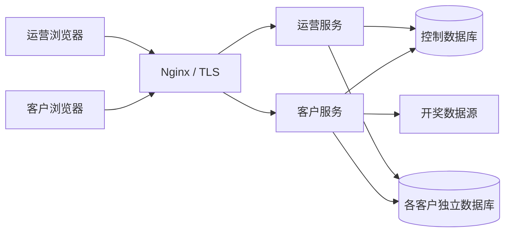

# 系统架构

MarkSix 采用浏览器、应用服务和数据库三层结构。客户工作台处理投注业务，运营管理端管理客户及授权。两端共享代码仓库，以独立进程运行。

## 应用边界

| 部分       | 职责                                 | 技术                                  |
| ---------- | ------------------------------------ | ------------------------------------- |
| 浏览器应用 | 页面、草稿、输入校验与结果呈现       | Svelte 5、TypeScript、Vite            |
| 客户服务   | 客户会话、投注账本、结算和风险计算   | Rust、Axum、Tokio                     |
| 运营服务   | 客户生命周期、授权、数据库开通与迁移 | Rust、Axum、SQLx                      |
| 数据存储   | 控制数据与独立客户账本               | MySQL 8.4                             |
| 部署层     | HTTPS、请求路由、镜像和持久化资源    | Nginx、Docker Compose、GitHub Actions |

前端通过同源 HTTP/JSON API 访问服务。客户服务与运营服务分别使用不同的数据库身份和浏览器会话。

## 数据边界

控制数据库保存平台客户、授权、会话和运营审计信息。每个客户拥有独立的业务数据库及数据库用户，保存玩法、期次、投注、结算与业务偏好。客户身份由服务端已验证的会话确定。

玩法、映射和投注具有不同的生命周期。玩法配置可以变更，已接受投注引用提交时的规则和费率快照；期次保留自身的映射及开奖结果。历史账目因此具有稳定的结算依据。

## 一致性边界

一张投注单的各分项与相关业务偏好在同一事务中提交。提交标识区分首次提交、同一请求的重试及内容冲突。

开奖驱动期次从待开奖进入结算状态。结算以期次为事务边界，投注与飞出账本一并更新。风险计算独立于入账，结果关联计算时的投注版本。

## 运行与交付

应用镜像与配置脚本属于发布版本；数据库、密钥、证书和备份属于持久化环境。两者在服务器上分开存放。

开发推送 `dev` 进行 CI；验收后合并 `master`，Actions 验证、打包并部署同一次构建。
